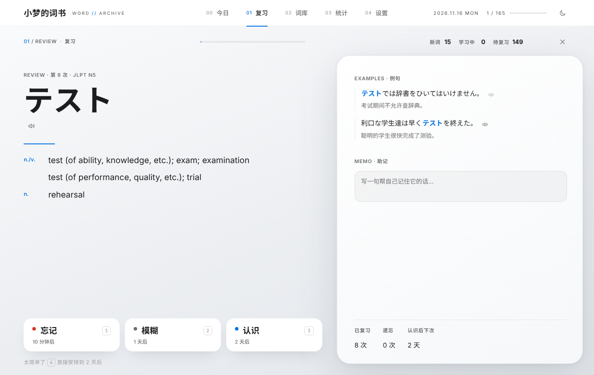

# 小梦的词书

一个在电脑上用的背单词程序：看到单词先自己回忆，再点「忘记 / 模糊 / 认识」，程序用 **FSRS 遗忘曲线算法**安排下一次复习。
数据全部存在本机，不需要账号，也不需要联网。


| 复习 | 统计 |
|---|---|
|  |  |

| 简约白配色 | 暗色模式 |
|---|---|
|  |  |

## 功能

- **回忆式复习**：显示单词 → 在心里回忆 → 显示答案 → 评分。全程可以只用键盘。
- **FSRS 调度**：根据你每个词的实际表现计算记忆稳定度，在快要忘的时候安排复习；可以调整期望保持率。
- **内置词书**：四级、六级、考研、托福、雅思、GRE、高考、中考；日语 JLPT N5–N1（英文释义）。
- **自己的词**：随手添加生词（自动查词典补释义），或导入 txt / csv / tsv / xlsx 词表。自己加的词总是优先学。
- **开箱即用的发音**：自带英语和日语语音包，词书里的每个词都能直接读出来，不用联网，也不用给系统装语音包。也可以换成在线真人发音或系统语音。
- **例句和助记**：英语、日语词书的绝大多数词都带例句，可以自己加例句、写助记。
- **例句发音**：点例句后面的小喇叭（复习时也可以按 `T`）朗读整句。例句太多没有内置：第一次播放时联网取一次真人发音并存在本机，
  复习时还会在后台提前下好今天要背的词的例句，所以背过的例句断网也能听；没网又没缓存时用系统语音。
- **拼写模式**：看释义拼单词，结果同样计入复习；另有不影响复习安排的自由拼写练习。
- **换设备继承进度**：在设置里导出一个进度文件（`.xmdb`，学了几千个词也只有几百 KB），拷到另一台设备上导入就能接着背，
  两边都有进度时会自动合并，不需要服务器。不方便传文件时，也可以把进度变成一串文字（进度密钥）复制过去。
- **统计**：连续天数、每日学习量、未来到期预测、保持率、单词状态、遗忘曲线、全年日历。
- **外观**：简约白（默认，柔和白底、圆角卡片、无衬线）和朱橙（纸白、衬线标题、斜切色块）两种配色；标题和正文的字体可以分别选系统字体或导入字体文件；配色都可以配暗色模式（右上角一键切换）；动画可以减弱。
- **按键音效**：可开关、可选音色（木质、毛毡、石子、键盘、玻璃），默认关闭。

## 安装和运行

需要 **Python 3.10 或更新版本**。

```bash
git clone https://github.com/QZLDream/LDream-wordbook.git
cd LDream-wordbook
pip install -r requirements.txt
python run.py
```

Windows 上直接双击 **「小梦的词书.exe」**（带小梦头像图标）就能打开：第一次运行时它会自动打开 `start.bat` 安装依赖，之后都是直接打开窗口。
想放到桌面，右键 →「发送到」→「桌面快捷方式」，不要把 exe 单独拖走（它要和其他文件在同一个文件夹里）。
`小梦的词书.exe` 的源码在 `tools/launcher/`，用 `pip install ziglang && python tools/launcher/build.py` 可以重新编译。
第一次打开时 Windows 可能提示“已保护你的电脑”（这个 exe 没有数字签名），点「更多信息」→「仍要运行」即可。

没装 PySide6 或者想在浏览器里用：

```bash
python run.py --browser
```

## 快捷键

| 场景 | 按键 | 作用 |
|---|---|---|
| 今日 | `Enter` / `空格` | 开始复习 |
| 复习 | `空格` / `Enter` | 显示答案 |
| 复习 | `1` `2` `3` | 忘记 / 模糊 / 认识 |
| 复习 | `4` | 太简单了（直接安排到较远的日期） |
| 复习 | `Z` | 撤销上一个 |
| 复习 | `R` | 再读一遍 |
| 复习 | `T` | 朗读第一条例句（显示答案后） |
| 复习 | `E` | 写助记 |
| 拼写 | `Enter` | 确认 / 继续 |
| 拼写 | `Tab` | 提示首字母（用了提示最多记为“模糊”） |
| 任意 | `Esc` | 退出复习 / 关闭弹窗 |

## 评分和算法

| 按钮 | FSRS 评分 | 含义 |
|---|---|---|
| 忘记 | Again | 没想起来。会在几分钟后重新出现 |
| 模糊 | Hard | 想起来了，但很费劲或不完整 |
| 认识 | Good | 正常想起来了 |
| 太简单了 | Easy | 早就会，间隔直接拉长 |

调度使用 [py-fsrs](https://github.com/open-spaced-repetition/py-fsrs)（FSRS-6，默认参数）。几个概念：

- **稳定度**：不复习的话，过多少天记得的概率会降到 90%。每次答对，稳定度变大，间隔变长。
- **期望保持率**（设置里可调，默认 90%）：程序会在预计保持率降到这个值时安排复习。调高记得更牢，但复习更频繁。
- **已掌握**：稳定度达到 21 天的词。
- 新词先经过两个学习步骤（1 分钟、10 分钟），连续答对后进入按天计的复习。
- 每天凌晨 4 点算作新的一天（可调）。

## 发音

设置里有三种来源，选中的那种没有某个词时会自动换下一种：

| 来源 | 说明 |
|---|---|
| **内置语音**（默认） | 随程序分发的语音包，覆盖全部英语词书（约 1.5 万词）和 JLPT 词表（约 8 千词）。英语是 Piper 合成的美音女声，日语是 Open JTalk 合成语音。完全离线。 |
| **在线真人** | 有道词典的公开发音地址。每个词第一次播放时联网获取，之后缓存在本机。不是官方开放接口，可能失效。 |
| **系统语音** | 操作系统自带的朗读，需要系统里装有对应语言的语音。 |

自己添加的生词不在语音包里：默认会联网取一次发音并缓存（可以在设置里关掉“联网补充”），取不到时用系统语音。

## 进度密钥（换设备继承进度）

设置 → 数据 → 进度密钥：

1. 在旧设备上点「生成密钥」，复制整串文字（以 `XMCS1.` 开头）。
2. 用任何方式把它带到新设备（聊天软件发给自己、网盘、U 盘里的文本文件都行）。
3. 在新设备上点「导入密钥」，粘贴，确认。

密钥就是压缩后的进度本身：学过的词和记忆状态、复习记录、自己加的词 / 助记 / 例句 / 释义、计划里的词书、学习设置。
它不经过任何服务器，所以长度随学习量增长（学了 600 个词大约 4 万个字符）。导入是**合并**：每个词以最近复习过的那一边为准，
复习记录取并集，所以两台设备来回同步也不会丢进度；导入前会自动备份。密钥不是密码，谁拿到都能导入这份进度。

## 导入词表

支持 `.txt` `.csv` `.tsv` `.xlsx`：

- 每行一个单词即可，释义和音标从内置词典自动补上；
- 或者写成“单词 + 释义”两列，用制表符、逗号、分号或两个以上空格隔开；
- 带表头的表格会自动识别列：`word / 单词`、`definition / 释义`、`reading / 音标 / 读音`；
- 含假名或汉字的词条按日语处理，其余按英语处理；
- 文本编码自动识别 UTF-8、GB18030、Shift_JIS。

## 数据在哪里

学习记录是一个 SQLite 文件 `user.db`（文件夹名沿用早期版本的代号 Shici）：

| 系统 | 位置 |
|---|---|
| Windows | `%APPDATA%\Shici\` |
| macOS | `~/Library/Application Support/Shici/` |
| Linux | `~/.local/share/shici/` |

复制 `user.db` 就是完整备份；设置页里也有“立即备份”“导出 CSV”。想放到别的位置（比如同步盘）：

```bash
python run.py --data D:\同步盘\wordbook
```

## 已知限制

- **一部分例句没有中文译文**：内置的英语考试词汇每个词都有例句，但带中文译文的只有一半多一点
  （中考 99%、高考 93%、四级 90%、考研 83%、六级 77%、雅思 73%、托福 56%、GRE 39%），其余是只有英文的例句或 WordNet 的用法短语。
  例句来源依次是：Tatoeba 的英汉对照句 → Tatoeba 只有英文的句子 → WordNet 用法示例 → 本项目自己编写的例句（约 800 个生僻词，带译文）。
  没有用机器翻译补译文：试过开源翻译模型，生僻词经常译错，对背单词反而有害。
  JLPT 词汇约 90% 有例句，译文有的是中文、有的是英文。
- **日语只有英文释义**：可自由分发的日汉词典数据很少，目前用的是 JMdict 的英文释义。可以在词库里逐个改成中文。
- **内置语音是合成的**：英语是 Piper 的神经网络合成语音；日语用的是 Open JTalk 的传统参数合成，机械感会更明显。个别词可能读得不标准，想要真人发音可以切到“在线真人”。
- **进度密钥会很长**：它装着全部进度，不是短口令。
- 目前只在 Linux 上实际运行过桌面窗口和 PyInstaller 打包；Windows / macOS 用的是同一套代码，但还没有逐项测试，遇到问题欢迎提 issue。

## 项目结构

```
shici/                 程序包（shici 是早期的内部代号）
  core.py              核心：数据库、每日队列、评分、词库、统计、进度密钥（界面调用的所有接口都在这里）
  scheduler.py         对 py-fsrs 的封装
  dictionary.py        读取内置词典和例句
  voice.py             发音来源：内置语音包、在线发音缓存
  importer.py          解析导入的词表
  server.py            只监听本机的 HTTP 服务，给界面提供接口
  desktop.py           PySide6 窗口（Qt WebEngine）、音频播放、系统语音
  data/                内置词典 dict_*.db 和语音包 audio_*.db（都是 SQLite）
  web/                 界面：HTML + CSS + 原生 JavaScript，没有构建步骤
    js/sfx.js          按键音效（Web Audio 现场合成，没有音频文件）
tools/
  build_dict.py        从 ECDICT / Tatoeba / WordNet / JLPT / JMdict 生成内置词典
  build_audio.py       用 Piper 和 Open JTalk 生成内置语音包
  build_fonts.py       裁剪界面字体
  seed_demo.py         生成一份演示用的学习记录
tests/                 核心逻辑和接口的自动化测试
```

界面和后端之间只通过 `POST /api/<方法名>` 传 JSON，对应 `core.py` 里的 `api_<方法名>`。
想改调度逻辑看 `core.py` 的 `_pick`（下一个出什么词）和 `api_answer`（评分后怎么更新）。
想换配色看 `web/css/app.css` 开头的颜色变量（`[data-palette="silver"]` 是简约白配色，变量在开头，形状和排版的改动在文件末尾）。

## 开发

```bash
pip install -r requirements-dev.txt
python -m pytest                      # 运行测试
python tools/seed_demo.py --data ./demo-data && python run.py --data ./demo-data   # 用演示数据看界面
```

### 打包成 exe（可选）

```bash
pip install pyinstaller
pyinstaller --noconsole --name XiaomengWordbook --icon shici/web/img/icon.ico --add-data "shici/web;shici/web" --add-data "shici/data;shici/data" run.py
```

（macOS / Linux 把 `;` 换成 `:`。）生成的程序在 `dist/XiaomengWordbook/`，体积有几百 MB，主要是 Qt WebEngine。
建议在只装了 `requirements.txt` 的干净虚拟环境里打包，否则电脑上装过的其他库也可能被打进去。

## 致谢和许可证

程序代码：MIT（见 [LICENSE](LICENSE)）。

内置的词典、例句、语音包和字体来自 ECDICT、Tatoeba、WordNet、tanos.co.uk 的 JLPT 词表、JMdict、Piper（LJ Speech）、
Open JTalk（HTS voice “Mei”）、Noto Serif、Inter、JetBrains Mono，各自的许可证见 [THIRD_PARTY_NOTICES.md](THIRD_PARTY_NOTICES.md)。
记忆算法来自 [open-spaced-repetition](https://github.com/open-spaced-repetition) 社区的 FSRS。

---

**小梦的词书 (Dream Wordbook)** is a desktop vocabulary trainer (Python + PySide6) that schedules reviews with the FSRS spaced-repetition
algorithm. It ships with English exam word lists (Chinese definitions), JLPT lists, bundled offline pronunciation for every built-in word,
example sentences, spelling drills, statistics, and a copy-paste “progress key” for moving to another device. All data stays local.
The interface is in Chinese.
